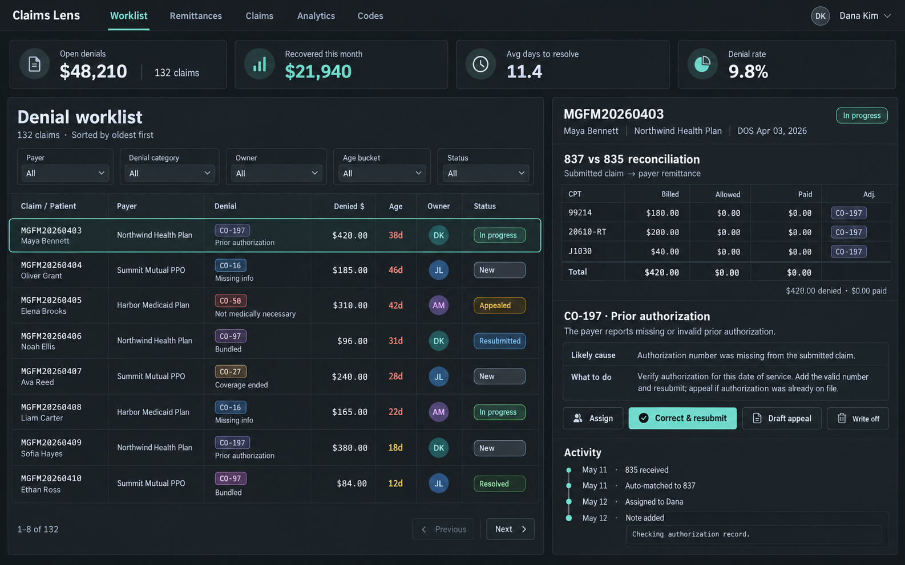

# Claims Lens

A denial-management workbench for physician billing teams: import 835 remittances, match them to the 837P claims you sent, and work every denial to a finish.

**Live demo:** https://claims.leixue.dev — one-click sign-in as a biller or a manager (fictional data, reset nightly).



## What it does

- **Import & reconcile** — upload 835s (and 837Ps). Each remittance is parsed, balance-checked, matched to the submitted claim by patient control number and line by line by procedure/modifier. Duplicate remittances are refused.
- **Worklist** — every non-routine adjustment (not CO-45 pricing, not PR cost-sharing) becomes a work item with its codes, denied amount, age and appeal deadline. Filter by payer, category, owner, age; sort by age, size or deadline.
- **Work a denial** — plain-English explanation of the CARC with likely cause and next steps; assign; add notes; **correct & resubmit** (generates a frequency-7 replacement 837P with REF*F8 = payer claim number); **draft an appeal letter** from the claim facts; resolve with the recovered amount or write off (over $500 needs a manager; only managers reopen closed work). Every action lands in the activity timeline.
- **Closed loop** — when a later 835 pays a claim that has an open denial, the denial resolves itself and the recovery is counted.
- **Analytics** — denied vs recovered dollars by reason, denial rate by payer and month, win rate, and which team can prevent each denial.
- **Inspector & code lookup** (no sign-in) — read any 837P/835 segment by segment with balancing checks; every active CARC and RARC explained.

## Stack

React 19 + TypeScript (Vite) · Hono API on Node 22 · PostgreSQL 17 + Drizzle · scrypt passwords, HTTP-only session cookies · Vitest integration tests against a real database · one Docker image (SPA + API) + Postgres, behind a Cloudflare Tunnel.

| Path | What |
| --- | --- |
| `web/src/lib/x12.ts`, `interpret.ts` | X12 tokenizer (delimiters from ISA), 835/837P models, balancing checks — shared by browser and server |
| `web/server/services/imports.ts` | 835/837 import, claim matching, denial creation and auto-resolution |
| `web/server/services/workflow.ts` | Status machine, corrected 837P, appeal letters |
| `web/server/seed.ts` | ~200 days of fictional claims sent through the real import path |
| `web/tests/api.test.ts` | End-to-end API tests |
| `pipeline/` | Content build for the plain-language CARC/RARC explanations |

## Run locally

```bash
cd web && npm install
npm run db:up && npm run db:seed      # Postgres in Docker on 127.0.0.1:5442
npm run dev:api & npm run dev         # API on :3000, app on :5173
npm test
```

## Content

CARC/RARC numbers and status come from the published [X12 code lists](https://x12.org/codes). The explanations are this project's own text: drafted by DeepSeek and audited batch-by-batch by Kimi against the official definitions (`pipeline/explain.py`). The official wording is not redistributed (`content/raw/` is git-ignored); each code links to X12. CPT descriptors are AMA-copyrighted, so procedures carry short labels written for the demo. ICD-10-CM descriptions are public domain.

## Deploy

`deploy/docker-compose.yml` runs the app image and Postgres on the shared tunnel network; `deploy/update.sh` rebuilds, `deploy/reset-demo.sh` (nightly cron) reseeds the demo.

Rebuild the code explanations (needs an OpenAI-compatible Ark key in the environment):

```bash
python3 pipeline/codes.py && python3 pipeline/explain.py && python3 pipeline/export.py
```

All patients, the practice and the payers are fictional. Not a clearinghouse or compliance tool — for learning and demonstration.
