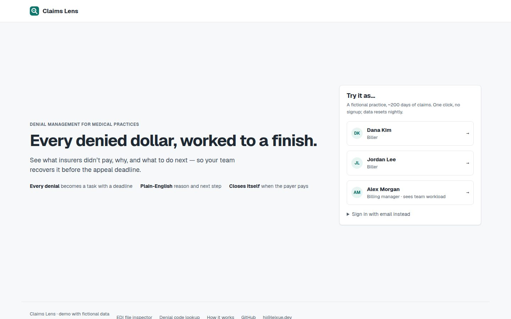
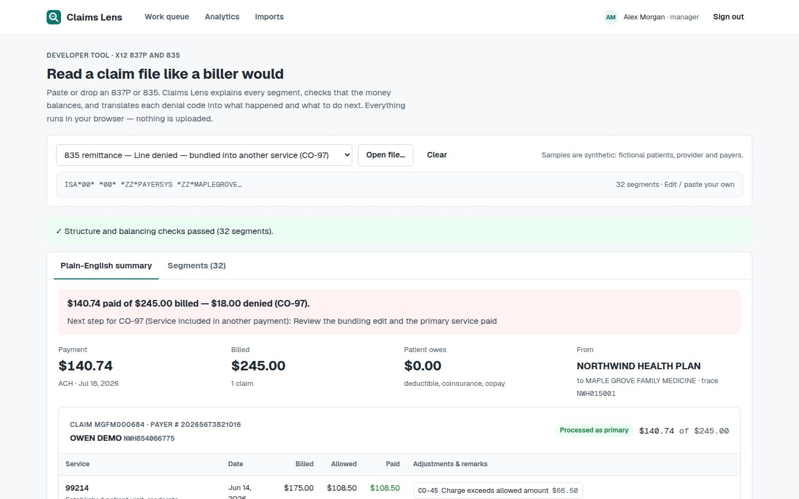

# Claims Lens

A denial-management workbench for physician billing teams: import 835 remittances, match them to the 837P claims you sent, and work every denial to a finish.

**Live demo:** https://claims.leixue.dev — one-click sign-in as a biller or a manager (fictional data, reset nightly).



| Work queue and a denial | File inspector (no sign-in) |
| --- | --- |
|  |  |

## What it does

- **Import & reconcile**: parse and balance-check 835s, match them to submitted 837Ps claim by claim and line by line; duplicates are refused.
- **Work queue**: every non-routine adjustment becomes a task with a plain-English reason, the amount and the appeal deadline; overdue work sorts to the top and managers see team workload.
- **Work a denial**: plain-English cause and next steps, notes, a corrected 837P (frequency 7) or a drafted appeal letter, resolve or write off (large write-offs need a manager), all on an activity timeline.
- **Closed loop**: when a later 835 pays the claim, its open denial resolves itself.
- **Analytics, inspector and code lookup**: denial and recovery trends; read any 837P/835 segment by segment; every CARC/RARC explained.

## Stack

React 19 + TypeScript (Vite) · Hono API on Node 22 · PostgreSQL 17 + Drizzle · scrypt passwords, HTTP-only session cookies · Vitest integration tests against a real database · one Docker image (SPA + API) + Postgres, behind a Cloudflare Tunnel.

## Run locally

```bash
cd web && npm install
npm run db:up && npm run db:seed      # Postgres in Docker on 127.0.0.1:5442
npm run dev:api & npm run dev         # API on :3000, app on :5173
npm test
```

Code explanations are this project's own text, checked against the official X12 code lists; neither the X12 wording nor AMA CPT descriptors are redistributed. Code map, content sources and deploy: [docs/details.md](docs/details.md).

All patients, the practice and the payers are fictional. Not a clearinghouse or compliance tool — for learning and demonstration.
