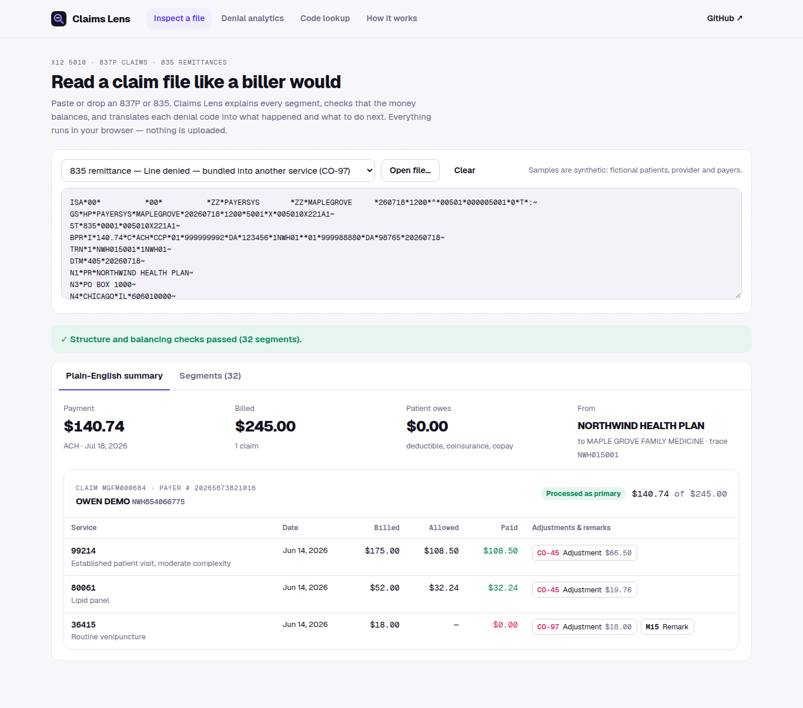

# Claims Lens

Read X12 **837P** claims and **835** remittances the way a medical biller does — in the browser, with nothing uploaded.

**Live:** https://claims.leixue.dev



- **Inspect a file** — paste or drop an 837P/835. Every segment and element is labelled, and the money is checked: claim charge − adjustments = paid, lines add up to the claim, claim payments − provider adjustments = the BPR payment, CLP05 = the PR adjustments, SE01 segment counts, control numbers, NPI check digits, diagnosis pointers.
- **Denial codes in plain English** — every active CARC and RARC with what it means, common causes, who usually fixes it and the next step.
- **Denial analytics** — a 1,500-claim synthetic dataset: denied dollars by reason, denial rate by payer and month, which team can prevent each denial, and a worklist that opens any claim's 835.

All patients, the practice and the payers are fictional; samples are generated from a fixed seed.

## Layout

| Path | What |
| --- | --- |
| `web/` | React + TypeScript + Vite app (static, no backend) |
| `web/src/lib/x12.ts` | Tokenizer — reads delimiters from the ISA header |
| `web/src/lib/interpret.ts` | 835 / 837P models and balancing checks |
| `web/src/lib/generate.ts` | Synthetic encounter + adjudication generator, 837P/835 serialisers |
| `pipeline/` | Content build: code-list parsing and plain-language explanations |

## Content

CARC/RARC numbers and status come from the published [X12 code lists](https://x12.org/codes). The explanations are this project's own text: drafted by DeepSeek and audited batch-by-batch by Kimi against the official definitions (`pipeline/explain.py`). The official wording is not redistributed (`content/raw/` is git-ignored); each code links to X12. CPT descriptors are AMA-copyrighted, so procedures carry short labels written for the demo. ICD-10-CM descriptions are public domain.

## Run

Self-hosted as a static nginx container behind a Cloudflare Tunnel (`deploy/`); `deploy/update.sh` rebuilds and publishes.


```bash
cd web && npm install && npm run dev
```

Rebuild content (needs an OpenAI-compatible Ark key in the environment):

```bash
python3 pipeline/codes.py && python3 pipeline/explain.py && python3 pipeline/export.py
```

Not a clearinghouse or compliance tool — for learning and demonstration.
